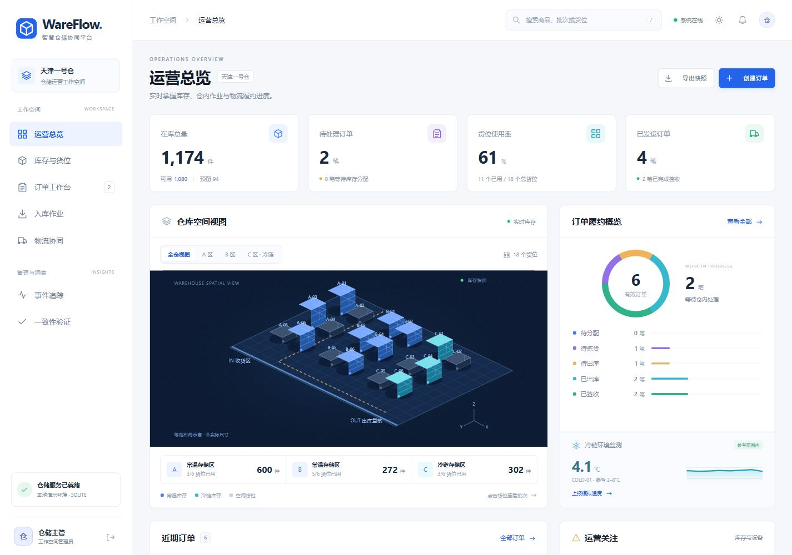

# WareFlow 栖序

河北工业大学 2026 软件工程实验 · 第四题 智慧仓储与物流协同系统。

一个能从批次入库演示到订单签收的仓储系统。业务核心采用事务一致性，物流协同通过持久化 Outbox 事件驱动。提供源码、UML、报告、自动测试、基准实验和答辩脚本。



界面已基于 [Tabler 开源组件](https://github.com/tabler/tabler) 重做，提供可交互的等距仓库图、订单履约环形图、冷链监测、明暗主题和商品全局搜索。全部样式由本机提供。开源选型、许可证和文件说明见 [前端设计与开源来源](docs/前端设计与开源来源.md)。

## 启动

Windows 双击 **启动系统.cmd**。当前电脑的依赖已安装，可直接运行；其他电脑需先安装 [Node.js 24 LTS](https://nodejs.org/)。首次安装依赖需要网络。

通用启动：

```sh
npm install --ignore-scripts
npm start
```

打开 [http://localhost:3210](http://localhost:3210)。账号 `admin`、`operator`、`viewer`，演示密码均为 `WareFlow2026!`。主管可以执行全部操作，作业员不能盘点、处理告警或控制事件消费，观察员只能读取。演示账号仅供本机课程环境使用。

## 标准 MySQL 部署

安装 Docker 与 Compose 后：

```sh
docker compose up --build -d
docker compose logs -f app
```

使用 MySQL 8.4 InnoDB 和持久化卷。默认只对本机开放 3210 端口。当前工作电脑没有安装 Docker CLI，Compose 本机部署尚未执行；业务适配已由 GitHub Actions 的真实 MySQL 8.4 服务验证。

## 完整演示

1. 入库作业登记批次，观察库存、流水和 StockReceived。
2. 创建多商品订单，分配库存，查看 FEFO 批次和拣货路线。
3. 确认拣货、复核出库，约 1.5 秒后物流协同出现运单。
4. 模拟揽收与签收，订单完成交付。
5. 运行一致性验证，核对数量守恒与事件摘要链。
6. 事件追踪暂停自动消费后创建订单，再注入故障，演示重试、死信与恢复。

详细讲述顺序、异常演示及常见问答见 [答辩演示手册](docs/答辩演示手册.md)。

## 可验证亮点

- **事务 Outbox**：库存、订单、流水、事件和幂等响应一起提交；运单投影由定时消费者创建，真实消费失败会持久化重试。
- **库存守恒**：在库和预留与流水、有效订单分配三方核对；预留整单回滚、取消释放、版本盘点与条件更新。
- **FEFO 与路线**：有效批次按效期优先，最近邻加 2-opt 提供货位建议。固定种子 1000 组任务相对编号顺序累计节省约 21.13% 网格步长，见 [原始基准数据](docs/benchmark-results.json)。
- **冷链告警**：模拟温度超阈值触发告警，连续异常合并，人工确认处理。
- **事件摘要链**：检测事件载荷被意外改写；没有外部可信锚点，不承诺数据库完全控制者无法重算。

## 测试与复现

```sh
npm test
node tools/benchmark.js
```

自动测试包括入库、并发预留、整单回滚、取消、盘点、签收、故障、幂等、越权与篡改检测。SQLite 使用内存隔离库。MySQL 测试只允许在名称以 `_test` 结尾的独立数据库执行。

GitHub Actions 每次推送执行 SQLite 和 MySQL 两个任务，MySQL 原始结果作为 `mysql-test-evidence` 构建产物保存。基准是小规模本机实验，不代表真实仓库生产吞吐或作业时间收益。

## 交付材料

- [实验报告 Word](docs/智慧仓储与物流协同系统实验报告.docx) 与 [Markdown 内容源](docs/实验报告.md)
- [UML 模型源与图片](docs/uml)：用例、领域类、包、部署、鲁棒、序列、活动和状态图
- [数据库完整字典](docs/数据库字典.md)、[接口与部署说明](docs/接口与部署说明.md)
- [答辩演示手册](docs/答辩演示手册.md)、[小组补充与提交清单](docs/小组补充与提交清单.md)
- [SQLite 自动测试记录](docs/test-results-sqlite.json)、[基准记录](docs/benchmark-results.json)

## 结构与边界

`src/domain.js` 集中业务规则；`src/db.js` 提供事务与两种数据库适配；`src/server.js` 提供认证及 REST；`public` 是本地页面与样式；`tests` 是可执行断言。

当前为单仓整数数量原型，商品与货位通过种子初始化；IoT、承运商和物流回调都是本地模拟。没有真实硬件接入、外部消息中间件或生产高可用集群。所有写事务使用全局锁以优先保障课程原型正确性，后续可按仓或商品分片。

基线由 Codex AI 辅助实现和验证，Git 提交如实使用 AI 作者。小组须进行人工审查、修改和解释，补充真实个人总结、协作提交与互评。封面个人信息按用户要求暂留待填，不编造成员贡献。
