# 一 软件需求规格说明书

## 1 项目概述与迭代规划

### 1.1 项目背景与目标

WareFlow 栖序面向中小型食品与日用品仓库，解决批次库存难以核对、订单与实物状态脱节、仓库出库后缺少物流衔接三个问题。系统以仓库作业员、仓储主管和业务观察员为主要用户，覆盖入库、在库管理、订单分配、拣货、复核出库及模拟物流签收。库存和订单是强一致的业务核心，运单是由出库事件驱动生成的协同投影。

本项目的验收目标是完成一笔从批次入库到客户签收的可追溯业务，证明任何预留、出库、取消和盘点操作均遵守库存守恒规则，并能够解释事件故障后的恢复行为。系统提供实际运行的 Web 工作台、MySQL 容器部署配置、SQLite 便携演示模式、自动化测试、UML 源文件和可复现实验数据。

本次范围为单仓、整数量单位和本地模拟承运商。真实 RFID、扫码枪、温度传感器、支付、采购审批、逆向物流及多租户不在本次实现范围。商品与货位由种子数据初始化，尚未提供商品档案维护界面。订单优先级供作业判断，系统未实现自动加急调度。此范围使课程原型集中体现软件工程设计与一致性验证。

### 1.2 迭代规划

以下采用三个一周 Sprint 作为小组后续实践计划，交付基线已经具备对应功能；该计划不代表小组已经经历了三周协作。小组应在实际执行后补充真实起止日期、评审结论与个人提交。

|迭代|目标与 Backlog|可工作的软件增量|退出条件|
|---|---|---|---|
|Sprint 1 一周|需求建模、入库、库存查询、持久化、权限|可登录并完成批次入库的库存工作台|正常入库、非法数量、冷链限制、库容测试通过|
|Sprint 2 一周|订单创建、FEFO 预留、拣货、出库、取消|可完成订单仓内履约与模拟物流联动|整单回滚、并发预留、库存守恒测试通过|
|Sprint 3 一周|温度告警、事件重试、路线基准、报告与部署|带验证中心和工程证据的演示基线|测试通过、UML 与代码一致、完整演示可重复|

用户故事地图以业务活动为主线，核心故事优先于扩展故事。验收每个故事时，必须同时检查正常输出、拒绝路径和数据变化。

|活动|MVP 用户故事|验收条件|增强故事|
|---|---|---|---|
|收货|作业员登记商品、批次、货位、数量、效期|库存增加，入库单和流水同步生成|冷链校验、同批次效期一致|
|在库|主管查询并盘点批次|盘点差异有原因与流水，旧版本被拒绝|效期关注、安全库存提醒|
|履约|作业员创建订单并分配库存|有效批次按 FEFO 分配，缺货全单回滚|可解释拣货路线与基线比较|
|发运|作业员复核出库并查看运单|库存扣减，事件消费后产生唯一运单|故障注入、指数退避与死信重放|
|监督|主管核对账实与事件|一致性校验明确显示差异位置|温度告警、事件摘要链校验|

### 1.3 需求到实现追踪

|编号|需求|实现位置|验证证据|
|---|---|---|---|
|FR01|批次入库与库容冷链校验|receive / POST receipts|M01 至 M08|
|FR02|库存查询与盘点|state countStock|M18 至 M20、M27|
|FR03|订单创建与有效批次预留|createOrder orderAction|M09 至 M12、M17、M29|
|FR04|拣货出库与取消释放|orderAction|M13 至 M16|
|FR05|物流创建与轨迹状态约束|dispatch trackingUpdate|M23 至 M25、M32|
|FR06|温度告警及异常合并|recordTemperature resolveAlert|M21、M30、M31|
|FR07|事件可靠消费与死信|dispatch / events 接口|M22、M23、M33|
|FR08|账实及事件链验证|reconcile|M25 至 M27|
|FR09|基于货位的路线建议|planRoute|M28、benchmark-results.json|
|FR10|会话认证与角色授权|server.js auth.js|F01 至 F04|

## 2 系统用例分析

### 2.1 角色分析

|编号|角色|所属部门|工作与权限|
|---|---|---|---|
|A01|仓库作业员 OPERATOR|仓储运营|登记入库、创建订单、分配、拣货、出库、取消、模拟物流及温度上报|
|A02|仓储主管 ADMIN|仓储管理|具备作业权限，另可盘点、处理告警、控制消费者与重放死信|
|A03|业务观察员 VIEWER|业务监督|读取库存、订单、物流、事件和校验结果，禁止修改业务|
|A04|模拟设备与承运商|外部协同边界|通过本地页面模拟采样与回调；尚未配置独立设备身份|

### 2.2 基本用例列表

|编号|用例|参与者|优先级|业务结果|
|---|---|---|---|---|
|UC01|登记批次入库|作业员 主管|P0|库存与入库单同步增加|
|UC02|查询库存与效期|所有登录角色|P0|显示批次在库、预留、可用与效期|
|UC03|版本校验盘点|主管|P0|调整账面数量并记录差异原因|
|UC04|创建出库订单|作业员 主管|P0|生成待分配订单与订单行|
|UC05|FEFO 库存预留|作业员 主管|P0|整单预留或整体拒绝|
|UC06|路线查看与拣货确认|作业员 主管|P0|展示访问顺序，确认拣货完成|
|UC07|复核出库|作业员 主管|P0|扣减实物及预留，产生出库事件|
|UC08|取消订单|作业员 主管|P0|释放已有预留，订单终止|
|UC09|查询及模拟物流更新|所有角色查询 作业角色更新|P0|运输与签收轨迹可追踪|
|UC10|温度采样与告警|作业员 主管|P1|异常采样触发或合并告警|
|UC11|处理告警|主管|P1|记录已核查状态|
|UC12|事件观察与故障演练|主管操作 所有角色查询|P1|观察重试、死信与恢复|
|UC13|一致性验证|所有登录角色|P1|定位库存与事件摘要异常|

### 2.3 用例建模

图 1 展示仓储核心用例，图 2 展示协同与工程验证用例。图中的主管权限泛化用于说明业务职责；实际访问控制由服务端角色白名单实现。界面可见某按钮不等于拥有接口权限，越权请求由服务端返回 403。

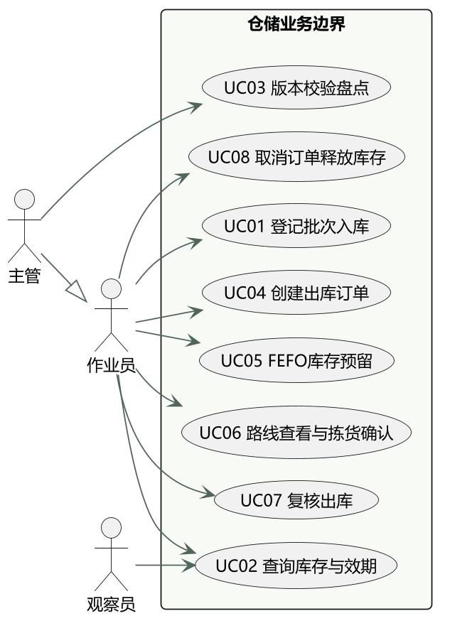

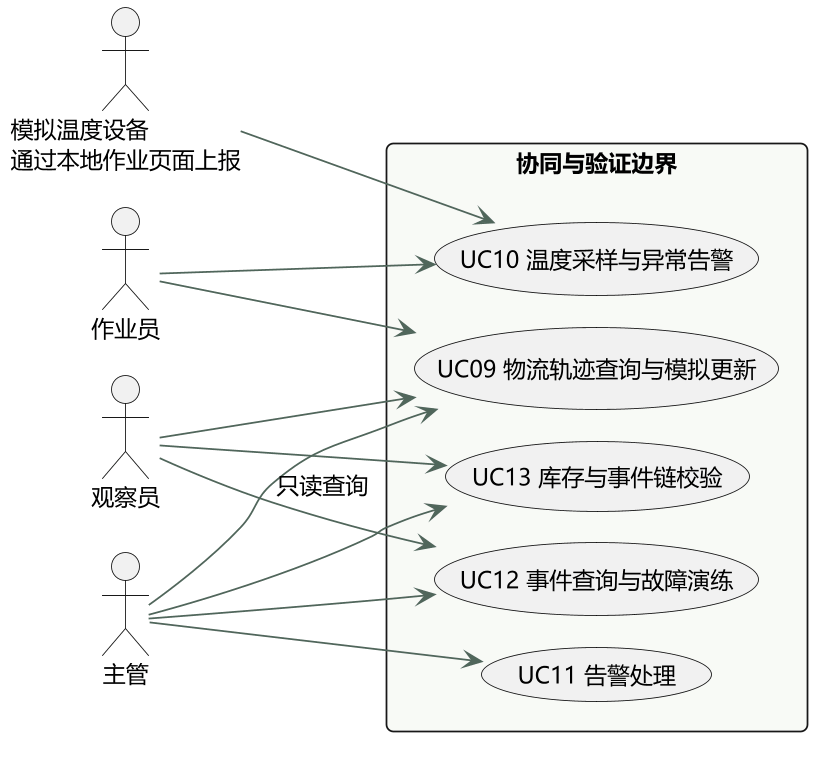

UC01 登记批次入库。前置条件为登录用户具有作业权限、商品和货位已初始化。用户提交商品、货位、批次、未来效期、正整数数量及供应商。系统先校验冷链属性、货位剩余容量和同批次效期，再在同一事务中创建或归并库存批次，增加在库量，记录入库单、库存流水及 StockReceived 事件。后置条件为库存、单据和流水保持一致。数量非法返回 400；货位或商品不存在返回 404；冷链不匹配、库容不足、批次效期冲突返回 409。任何失败均回滚整笔请求。

UC03 版本校验盘点。主管读取批次数量与 version，提交实盘数量及原因。系统核对 version 与数据库版本一致，检查实盘量不少于预留量、货位不超容，再记录 COUNT 差异流水与 StockCounted 事件。若读后发生入库或预留，旧版本请求返回 409，主管须刷新重盘。盘点用于对已核实的实物差异作账务修正，不自动解除其他订单的预留。

UC05 FEFO 库存预留。前置条件为订单处于 CREATED。系统对每个商品筛选效期晚于当日且 on_hand 大于 reserved 的批次，按效期、批次、货位和批次主键排序，逐批计算 take=min(remaining, on_hand-reserved)。每次预留记录 Allocation 和 RESERVE 流水。所有行满足后，订单变为 RESERVED，并产生 InventoryReserved。任意商品不足时，整个事务回滚，先前已处理商品也不留下预留。图 9 给出复杂事件流的活动模型。

UC06 路线查看与拣货确认。前置条件为订单已预留。系统从分配明细提取去重货位，计算启发式路径并显示基线路程、建议路程和节省步长。作业员完成实物拣选后确认，订单变为 PICKED；此时实物库存尚未扣减。路径是工作建议，不替代实物复核。系统未对每行扫描结果或短拣差异建模。

UC07 复核出库。订单必须为 PICKED。系统将各分配批次的 on_hand 和 reserved 同时减去出库量，记录 SHIP 流水，把订单改为 SHIPPED，写入 OrderShipped。接口返回后，独立消费者创建运单和首条轨迹。若消费者暂时失败，仓库已出库事实继续有效，事件进入重试，而不会再次扣减库存。

UC08 取消订单。CREATED、RESERVED、PICKED 状态可以取消。系统将分配对应的预留全部释放，记录 RELEASE 流水并产生 OrderCancelled；PICKED 状态取消需要人工归位，软件只处理账面释放。已 SHIPPED 或 DELIVERED 的订单拒绝直接取消，后续退货属于未实现的逆向物流。

UC09 物流更新。出库事件消费成功后，运单状态从 CREATED 到 IN_TRANSIT 再到 DELIVERED。每次更新需要幂等键与轨迹说明，禁止跳过揽收直接签收。签收同时将关联订单改为 DELIVERED。同一回调键和载荷返回首次结果，不重复生成轨迹；新键重复旧状态返回 409。这里模拟的是协议语义，不连接真实承运商。

UC10 与 UC11 温度告警。COLD-01 上报数值温度，正常参考范围为闭区间 2 至 8 摄氏度。超出范围时创建一条 OPEN 告警；未处理期间的连续异常复用同一告警。主管核查后处理告警。恢复正常不会自动关闭告警，告警也不会自动冻结冷链库存，以避免把未经人工核查的传感器读数直接转化为库存处置。

UC12 事件故障演练。主管暂停自动消费后创建业务事件，注入消费异常。失败次数持久化，重试间隔按 1000×2^attempts 毫秒增长并限制为 60 秒，达到五次进入 DEAD。管理员重放会保留事件身份和载荷，将尝试次数归零。演示页面的手动消费允许跳过等待时间，实际定时 worker 仍遵守 available_at。

UC13 一致性验证。系统在同一数据库快照内比较库存、流水和有效订单预留，并校验事件序号、前序摘要和事件内容哈希。正常结果显示批次数及事件数；异常结果返回具体批次差异和损坏事件序号。验证只读，不自动修复数据。

### 2.4 数据建模

从业务叙述抽取“商品、货位、批次、入库单、订单、订单行、分配、流水、运单、轨迹、设备采样、告警、事件”等名词，合并同义概念，剔除“效率、可视化”等非实体词。商品与货位为主数据；Lot 是带批次和效期的库存事实；Allocation 连接订单与批次，解决一个商品跨多个批次分配的问题；StockMove 记录数量变化，使库存守恒可计算。

|CRC 候选类|责任|协作对象|
|---|---|---|
|Product|商品身份、安全库存、冷链属性|Lot OrderLine|
|Location|分区、容量、路线坐标|Lot|
|Lot|保有在库、预留与版本边界|Location Allocation StockMove|
|Order|约束履约状态流转|OrderLine Allocation Shipment|
|Allocation|保存每个订单使用的批次数量|Order Lot|
|OutboxEvent|保存业务变化、消费状态和摘要|领域命令 dispatch|
|Shipment|记录物流生命周期|Order Tracking|
|Alert|保留异常及处理时间|Reading 主管|

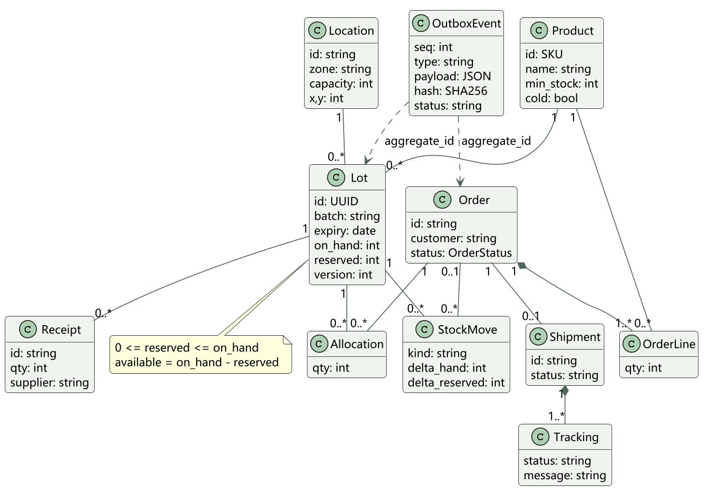

## 3 非功能需求

|编号|质量目标|可检验标准|实现及验证边界|
|---|---|---|---|
|NFR01|一致性|所有成功操作后 0≤reserved≤on_hand；流水与有效分配相符|事务、条件更新、数据库 CHECK 与 reconcile；并发争抢测试|
|NFR02|可靠性|同键重试不重复改变库存；已提交事件不因进程退出而消失|幂等表与 Outbox 持久化；消费副作用与确认同事务|
|NFR03|响应性|演示数据下 10 并发查询 P95 小于 500 毫秒|同机 100 次读取基准，实际数据见第四章；不是生产容量承诺|
|NFR04|安全性|未认证 401、越权 403；口令不明文保存|scrypt 哈希、HttpOnly SameSite Cookie、同源写入校验、参数化 SQL|
|NFR05|可用性|关键操作有状态提示、失败原因和确认步骤|取消确认、服务端错误反馈、数量限制、搜索与筛选|
|NFR06|可维护性|业务规则集中、接口与持久化分离、模型可编辑|domain.js db.js server.js 分层，PlantUML 源文件随代码交付|
|NFR07|可部署性|本机演示无需数据库安装，标准部署使用 MySQL|Node.js 24 与 SQLite；Docker Compose 配置 MySQL 8.4|

# 二 设计规格说明书

## 1 设计概述

系统采用具有事件驱动协同机制的模块化单体。接口层负责认证、授权和输入传递，领域层负责库存与订单规则，基础设施层提供事务及数据库适配。库存、订单、分配和流水在一个数据库事务中保持强一致；仓储出库到物流运单的衔接使用持久化 Outbox，实现协同模块之间的最终一致。

项目以适合课程小组理解和验证为约束。没有将每个业务模块拆成独立微服务，也没有把所有功能堆在页面中。领域事件确实写入数据库并由定时消费者读取，物流运单确实由 OrderShipped 触发生成。Outbox 是事务消息机制，本项目没有外部 RabbitMQ 或 Kafka，不将其描述为已建成的分布式消息集群。

## 2 总体设计

### 2.1 架构决策与选型

|方案|一致性支持|课程部署与调试成本|事件协同能力|结论|
|---|---|---|---|---|
|同步分层单体|单事务容易保障|低|接口直接调用耦合物流，失败恢复需额外设计|作为基础分层方案，补充事件机制|
|独立微服务及消息中间件|需设计分布式一致性与补偿|高，需要多个服务与消息基础设施|扩展性强，但增加课程交付风险|作为规模扩大后的演进方向|
|模块化单体与事务 Outbox|库存强一致、协同最终一致|中低，仅需应用和数据库|持久化事件、幂等消费、失败重试可验证|本次采用|

ADR01 决策为“模块化单体加事务 Outbox”。依据是单仓作业对库存精度要求高，课程原型更需要可复现的正确性。使用统一事务避免订单状态和库存之间的分布式提交问题，同时利用事件隔离物流投影。代价是目前所有写事务经过全局锁串行化，在高负载时存在吞吐瓶颈。未来可按仓或商品建立锁分片，但须同时处理跨商品订单的死锁与一致性问题。

ADR02 决策为“双持久化适配”。MySQL 8.4 是符合指导书数据库方向的标准部署；SQLite 是方便答辩电脑启动的便携模式。业务 SQL 使用参数绑定，核心数据结构保持相同。SQLite 使用 BEGIN IMMEDIATE 与 WAL；MySQL 使用专用连接事务和 system_lock 的 SELECT FOR UPDATE。对同一应用实例，Promise 队列还会防止异步请求交错使用事务。此策略优先正确性与可解释性。

ADR03 决策为“事件副作用与消费确认同库事务”。物流模拟器保存在相同数据库，消费时通过 shipments.order_id 唯一约束去重，并在同一事务标记 DONE。若未来调用真实承运商，外部 HTTP 副作用无法通过本库回滚，需要使用稳定业务单号、承运商幂等接口、签名验真与对账补偿，本次不声称解决跨系统 exactly-once。

### 2.2 系统逻辑架构

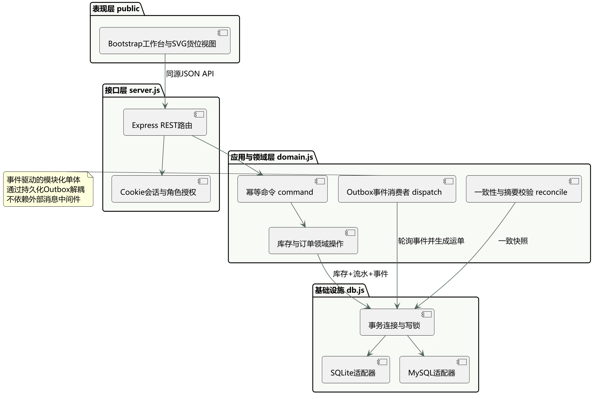

表现层只调用同源 REST API，不直接访问数据库。业务写入口统一经过 command：检查幂等键、计算指纹、执行领域规则、保存响应并提交。domain.js 采用函数式领域服务实现，不为了类图而虚构不存在的 Java 类。UML 中的实体类表示分析和设计概念，其持久化映射是关系表。

### 2.3 系统物理架构

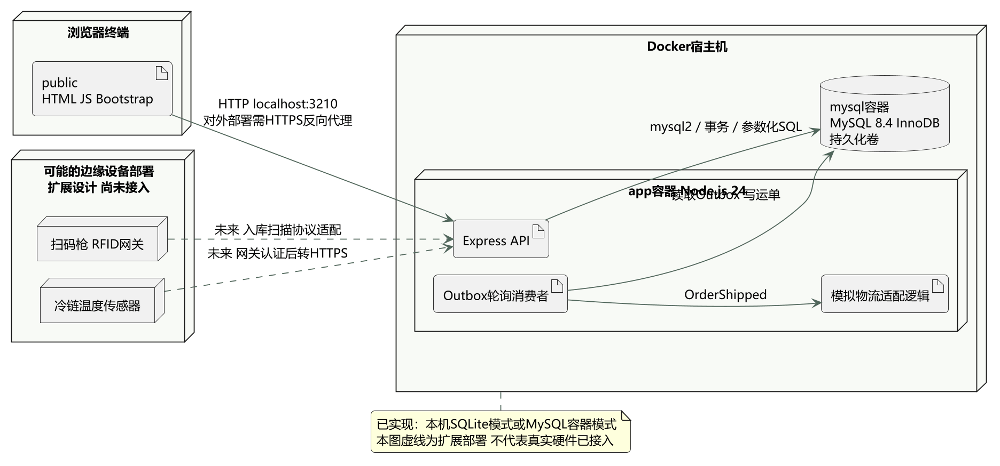

本机模式绑定 127.0.0.1:3210，SQLite 文件位于 data/wareflow.db。容器模式由 app 与 mysql 两个服务构成，MySQL 数据卷提供持久化，数据库健康检查通过后启动应用。外部端口默认仍绑定宿主机回环地址。真实外网部署需在反向代理上终止 HTTPS，并启用 COOKIE_SECURE=1。本次没有执行公共云部署。

部署图中的 RFID 网关与温度传感器使用虚线表示可能的扩展方式，实际系统以模拟页面发起采样和物流更新。扩展时需给设备和承运商建立独立身份、签名、时间戳与重放窗口，不能复用作业员的会话认证协议。

## 3 模块设计

### 3.1 用例实现与设计类归纳

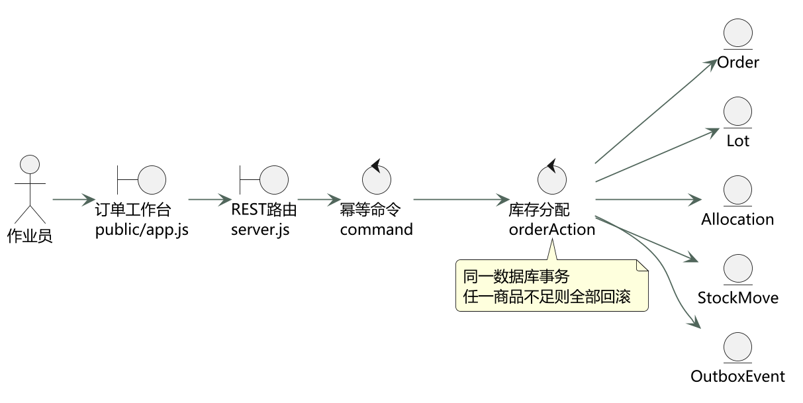

|序号|实体概念与关系表|控制职责与实际函数|边界对象与实现|
|---|---|---|---|
|1|Lot Receipt StockMove|receive command|入库表单、POST /api/receipts|
|2|Order OrderLine|createOrder|订单创建表单、POST /api/orders|
|3|Lot Allocation Order|orderAction reserve 分支|订单工作台、预留接口|
|4|Lot StockMove Order|orderAction ship cancel 分支|拣货与复核按钮|
|5|OutboxEvent Shipment Tracking|dispatch trackingUpdate|事件追踪、物流时间线|
|6|Lot StockMove|countStock reconcile|盘点表单、一致性验证页面|
|7|Reading Alert|recordTemperature resolveAlert|温度采样表单与告警处理|

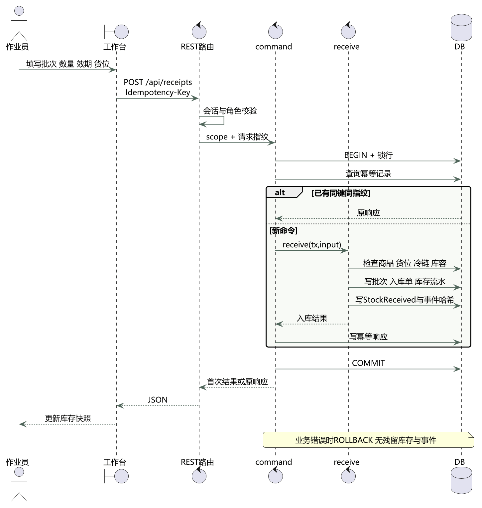

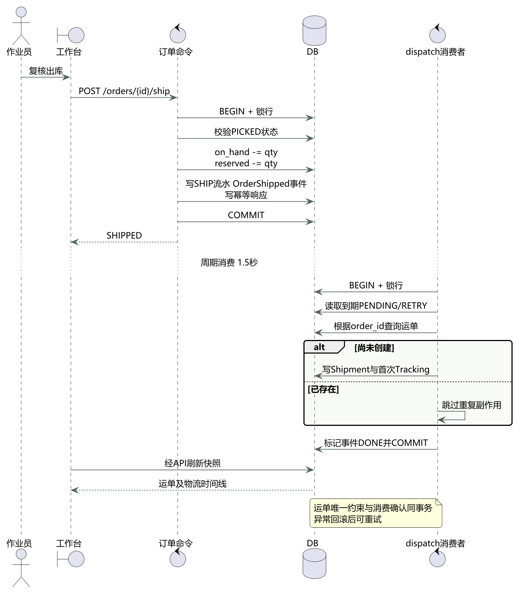

### 3.2 关键程序逻辑

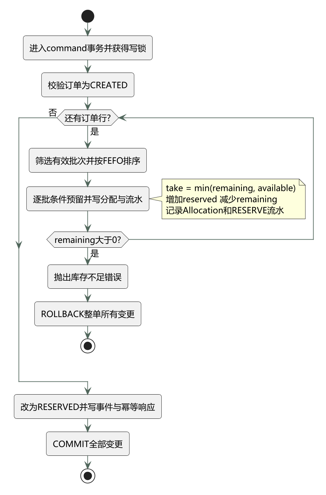

库存不变量为 available=on_hand-reserved，0≤reserved≤on_hand。入库令在库增加 q；预留只增加 reserved；出库令两者同时减 q；取消只减少 reserved；盘点使在库变化 counted-on_hand。所有操作都写 delta_hand、delta_reserved 流水。对于每个批次，当前在库等于流水 delta_hand 的代数和，当前预留等于 delta_reserved 的代数和，还必须等于 RESERVED 与 PICKED 订单的 Allocation 之和。三种表示相互校验，避免“只检查库存不为负”掩盖漏释放和漏记账。

预留使用稳定 FEFO 顺序而非仅按创建时间。过期与当日到期批次保守地不参与分配。跨批次分配只记录实际使用量；跨商品整单预留失败触发异常，外层 command 回滚全部变更及事件，不返回部分成功。MySQL 全局写锁保证两个订单不能同时读取并消耗相同可用量；UPDATE 仍保留 on_hand-reserved>=take 的防御性条件。

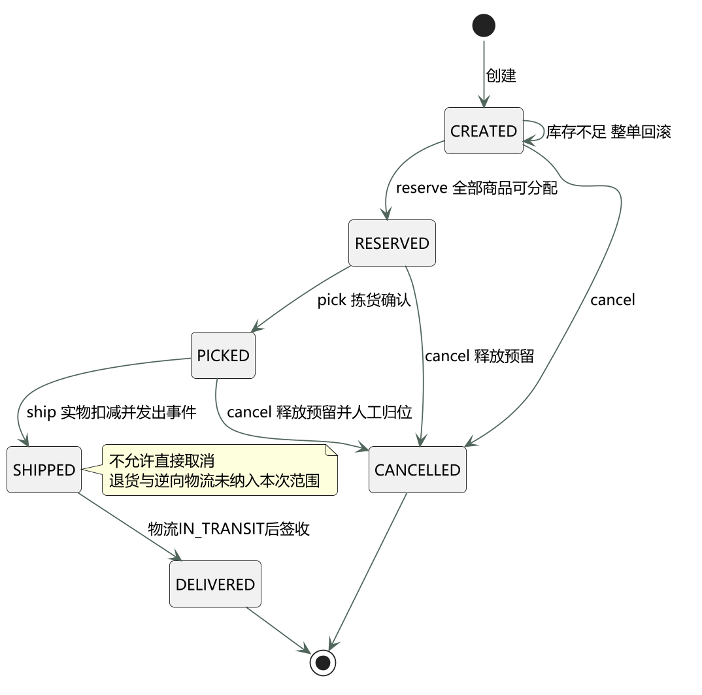

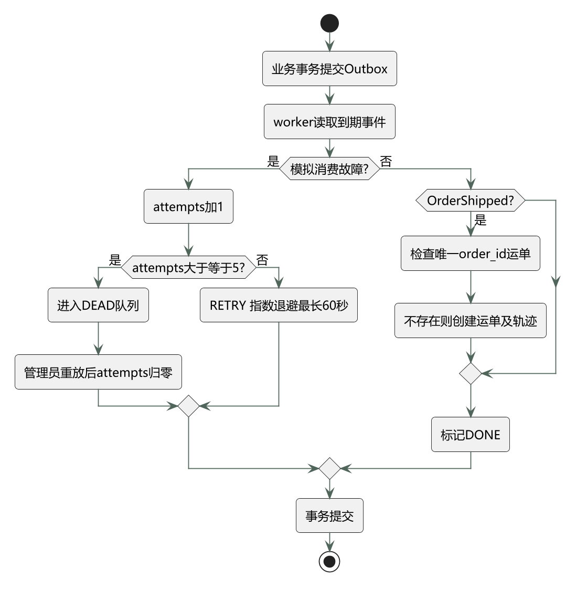

事件状态与业务载荷分开维护。哈希输入包含 seq、type、aggregate_id、payload、created_at 和 previous_hash；status、attempts 等投递元数据可以正常更新而不破坏内容摘要。消费者按序号读取到期事件；因重试和死信存在，不承诺跨故障事件的全局严格消费顺序。本次消费者只有 OrderShipped 会创建物流副作用，因此不依赖其他事件的全局顺序。

### 3.3 可解释拣货路线

planRoute 将同订单的多个批次货位去重，使用货位坐标计算曼哈顿距离。起止点均为坐标 0,0 的复核台。先用最近邻构造路线，再以 2-opt 逆转局部片段，只接受严格缩短的替换；如果最终路线反而长于按货位编号访问的基线，则直接采用基线。该保底策略确保显示的节省量不为负。

算法适用于本次小规模双向网格示意，不建模障碍、单向通道、拥堵和货物体积。最近邻构造为平方量级，2-opt 每轮比较平方数量的候选片段，本实现每次还重新计算路线长度，单轮约为立方量级；不将其声称为严格二次复杂度或全局最优算法。报告的对比实验采用固定随机种子，避免挑选有利案例。

### 3.4 API 与模拟物流协议

所有业务接口需要登录 Cookie，写业务命令还需 Idempotency-Key，长度为 8 至 64 字符。幂等指纹包括用户、动作、资源与请求 JSON；当前实现以序列化后的 JSON 计算指纹，字段顺序不同会被视为不同载荷，调用方重试应原样发送请求。操作成功返回 JSON 结果，400 表示输入错误，401 表示未登录，403 表示无权限，404 表示对象不存在，409 表示业务状态或幂等冲突。

|方法与路径|用途|写权限|
|---|---|---|
|POST /api/login|换取 8 小时会话|公开登录入口|
|GET /api/state|一致快照查询|所有登录角色读取|
|POST /api/receipts|批次入库|ADMIN OPERATOR|
|POST /api/orders|创建订单|ADMIN OPERATOR|
|POST /api/orders/:id/reserve|整单预留|ADMIN OPERATOR|
|POST /api/orders/:id/pick|拣货确认|ADMIN OPERATOR|
|POST /api/orders/:id/ship|复核出库|ADMIN OPERATOR|
|POST /api/orders/:id/cancel|取消释放|ADMIN OPERATOR|
|GET /api/orders/:id/route|拣货路线建议|所有登录角色读取|
|POST /api/counts|版本校验盘点|ADMIN|
|POST /api/shipments/:id/tracking|模拟物流回调|ADMIN OPERATOR|
|POST /api/readings|模拟温度上报|ADMIN OPERATOR|
|POST /api/alerts/:id/resolve|核查告警|ADMIN|
|POST /api/events/dispatch|消费或故障注入|ADMIN|
|POST /api/events/worker|暂停或恢复 worker|ADMIN|
|POST /api/events/:id/retry|死信重放|ADMIN|
|GET /api/reconcile|库存与事件完整性核对|所有登录角色读取|

模拟物流更新请求示例为 {"status":"IN_TRANSIT","message":"模拟承运商已揽收"}。运单状态只允许 CREATED→IN_TRANSIT→DELIVERED。OrderShipped 的 payload 包含 order_id 和 status，aggregate_id 同为订单号。运单号采用 WF 加订单业务号，订单到运单为一对零或一关系。

## 4 数据库设计

### 4.1 领域模型到关系表映射

实体身份统一使用字符串主键，明细通过外键关联；订单与商品通过 order_lines 表达多对多，订单与库存批次通过 allocations 表达多对多。批次库存使用唯一组合 product_id、location_id、batch。Shipment 通过唯一 order_id 避免重复投递产生多个运单。不可删除的业务记录保留外键保护，本次不提供业务物理删除接口。

数据以整数存储数量，避免浮点误差；温度使用 DECIMAL(6,2)，允许负值并在服务层校验范围。效期使用 ISO 日期字符串，时间戳使用 UTC ISO 8601，界面在本地时区展示。数据库 CHECK 保证核心数量边界，服务端进一步约束单次数量上限、日期真实性、货位容量与状态规则。数据库字段长度与业务限制同时存在，不能仅依赖前端表单校验。

### 4.2 表清单与完整字段字典

下列字典由 src/schema.sql 自动提取，并附中文字段含义、默认值、非空、主外键与索引说明，见本报告附录 A。MySQL InnoDB 的主键索引为聚簇索引；唯一索引为辅助 B 树索引。SQLite 使用其自身 B 树索引机制，不套用 InnoDB 聚簇索引概念。外键可能由 MySQL 隐式建立辅助索引，具体名称应以数据库 SHOW INDEX 输出为准。

当前表规模面向课程数据，除主键和业务唯一约束外没有增加性能索引。大量业务下，应根据执行计划为 lots(product_id,expiry)、stock_moves(lot_id)、outbox(status,available_at,seq) 等查询增加索引，并评估写放大。这里将性能索引作为演进建议，避免与实际建表语句混淆。

# 三 系统原型构建与实现

## 1 原型概述

原型使用 Node.js 24、Express 5、Bootstrap 5.3 和模块化原生 JavaScript。Bootstrap 满足现代 Web 界面构建要求，业务交互使用可读的 ES Modules。标准持久化后端为 MySQL 8.4，便携模式使用 Node 内置 SQLite。样式采用深绿色导航、浅色工作区和橙色主动作，围绕“状态、数量和操作证据”组织视觉层次。

项目包含运营总览、库存与货位、订单工作台、入库作业、物流协同、事件追踪、一致性验证七个页面。主数据初始化为 8 种商品、18 个货位及少量演示订单，所有演示变化均通过领域函数写入流水。页面数字由接口读取真实持久化状态，不用硬编码营业额、预测收益或虚构实时数据。

## 2 运营总览与库存管理

总览输入为当前库存、订单和设备快照，输出在库总量、预留量、订单阶段和货位占用。货位图以 SVG 渲染，颜色区分常温、冷链与空闲；点击货位可查看实际批次。低库存使用有效未过期批次的可用量与安全阈值比较，效期关注展示 30 天内批次。总览的总可用统计为账面在库减预留，过期不可分配的说明在库存页提示，不能将其与有效可分配数量混为一谈。

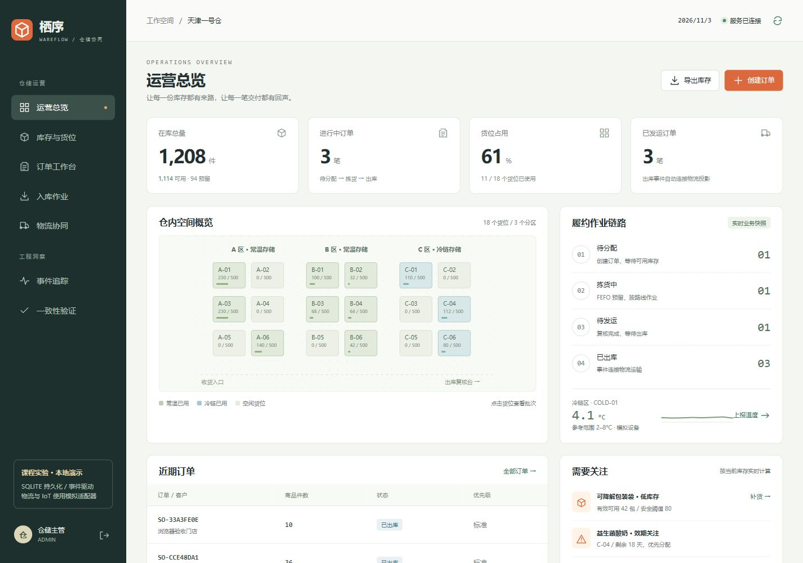

库存页面支持商品、批次、货位搜索和分区筛选，区分在库、预留、可用和效期状态。导出 CSV 包含 BOM 便于 Excel 读取，并对公式前缀进行防护。主管盘点时提交原 version，服务端再次检查数量边界和容量，防止旧页面覆盖新库存。

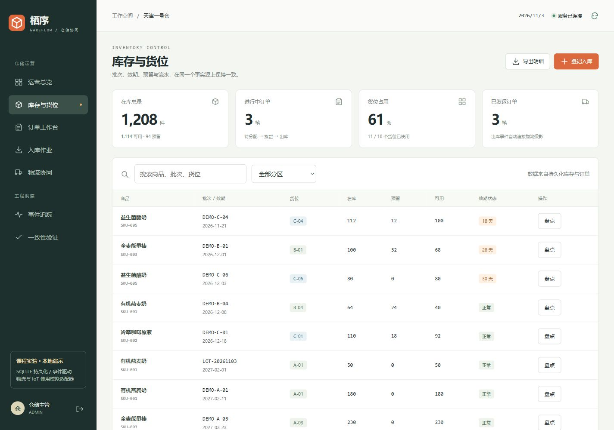

## 3 订单履约与物流协同

创建订单输入客户、目的地、优先级和商品行，输出 CREATED 订单。分配库存后可查看具体使用的批次与货位，拣货完成后复核出库。按钮随状态显示可用动作，服务端独立校验状态机，避免绕过界面直接调用非法操作。

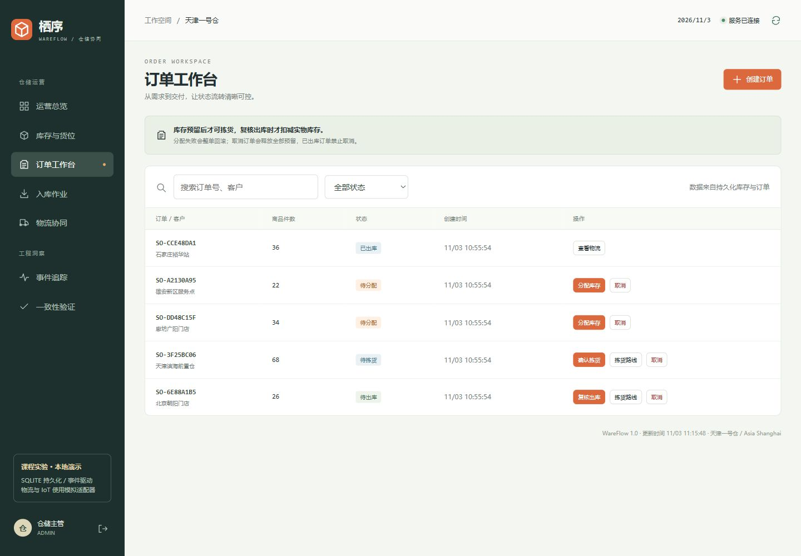

物流页面显示由事件生成的运单和轨迹时间线。模拟承运商揽收后可签收，签收状态回写订单。演示时可暂停消费者，观察订单已出库而运单尚未产生，再恢复消费观察最终一致，清楚区分仓储事实与物流投影。

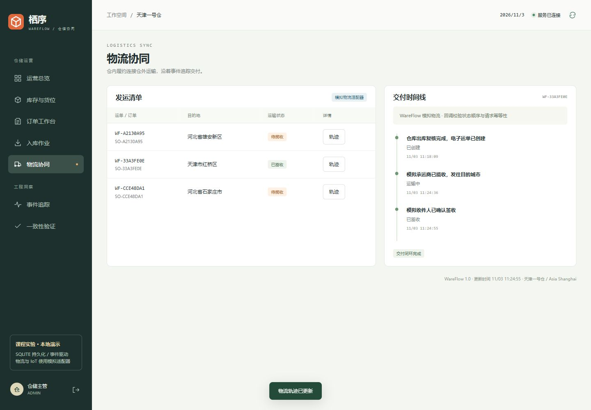

## 4 核心代码说明

以下为与源码一致的预留逻辑摘录，省略了周边状态校验。take 不大于剩余需求及当前可用量；UPDATE 再次验证边界，任何失败通过外层事务回滚。

```javascript
const take = Math.min(remaining, lot.on_hand - lot.reserved);
const result = await tx.run(
  'UPDATE lots SET reserved=reserved+?,version=version+1 '
  + 'WHERE id=? AND on_hand-reserved>=?',
  [take, lot.id, take]
);
check(result.changes === 1, '并发库存冲突，请重试', 409);
// 同事务写入 Allocation、RESERVE 流水和领域事件
remaining -= take;
```

下例为消费者故障后的持久化策略摘录。副作用失败先回滚，再用独立事务记录重试状态。真实数据库异常与演示故障都经过该失败路径，M33 通过制造唯一键冲突验证这一点。

```javascript
const attempts = e.attempts + 1;
const status = attempts >= 5 ? 'DEAD' : 'RETRY';
const availableAt = new Date(
  Date.now() + Math.min(60000, 1000 * 2 ** attempts)
).toISOString();
// 独立事务保存 attempts、status、error、available_at
// 运单创建和 DONE 确认在先前副作用事务中一起提交
```

## 5 创新点与可验证价值

创新点一为可解释 FEFO 与路线协同。库存分配解释“为什么选这个批次”，拣货路线解释“按什么顺序访问货位”，界面同时展示优化前后步长，避免只有一个无法验证的“智能优化”结论。

创新点二为可演练的可靠事件链路。主管能够暂停消费、注入故障、观察重试、进入死信并重放，演示事件驱动架构的实际行为。出库请求与后续运单投影通过持久化事件连接，重复消费不会重复扣减库存或创建运单。

创新点三为数量守恒验证中心。库存快照、库存流水和有效订单分配三方核对，既能发现库存数被改写，也能发现预留与订单分配脱节；事件摘要链再提供内容完整性检查。摘要链没有外部可信锚点，不能阻止数据库完全控制者重算整条链，因此不宣称具有区块链式不可篡改保证。

创新点四为冷链告警与人工处置闭环。温度模拟超阈值产生告警，连续异常合并，主管核查后关闭。告警与库存处置分离，体现软件对物理世界不确定性的边界意识。这些增强功能均可在页面操作并由数据库与测试核对。

# 四 测试报告

## 1 测试方案

测试采用 Node.js 内置 node:test 与 strict assert，测试数据来自隔离数据库，不对答辩演示数据做清空。SQLite 单测使用内存库；MySQL 测试强制要求独立的 *_test 数据库，并按外键依赖顺序清理该测试库。测试组合包括领域组件测试、REST 权限测试、端到端业务流、故障注入和确定性算法基准。

测试输入、断言和执行结果随仓库交付，执行时间与耗时自动写入 test-results-sqlite.json。测试执行者记录为自动化程序，不能据此填写某个组员的人工测试经历。GitHub Actions 额外启动 MySQL 8.4 服务并执行相同业务测试，其结果应以对应运行记录和下载的测试证据为准。

## 2 组件测试与基本路径法

选取 recordTemperature 的抽象控制流作为基本路径分析对象。将设备合法性、温度合法性、是否超出阈值、是否已有未处理告警视为四个判定节点，在该抽象层次圈复杂度 V=D+1=5。复合条件内部的短路分支不在这五条抽象路径内单独计数；补充等价类验证数值边界。该说明避免将抽象路径测试冒充源码完整分支覆盖。

|路径|判定序列与输入|期望输出|用例证据|
|---|---|---|---|
|P1|未知设备，温度 4|404，不写采样|M30|
|P2|已知设备，温度超出 -50 至 80 或非数值|400，不写采样|M31|
|P3|合法设备，温度 2 或 8|正常采样，无告警|M21|
|P4|合法设备，首次温度 1.9|写采样并创建 OPEN 告警|M21|
|P5|已有 OPEN 告警，再上报 8.1|记录采样，复用告警，不重复创建|M21|

库存组件的边界与异常还覆盖零、负数、小数、超限数量、非法日期、冷链误放、容量不足、批次效期冲突、多商品部分可分配、过期批次、取消释放及陈旧盘点版本。并发用例同时发起八笔各需 30 台的订单争抢 36 台库存，断言只允许一笔成功，并在操作后校验流水、预留与分配守恒。

## 3 功能测试与等价类划分

|功能|有效输入类|无效输入类|预期行为|
|---|---|---|---|
|入库数量|1 至 100000 的整数|0、负数、小数、文本、超上限|有效写入，其余 400|
|效期|晚于业务当日的合法日期|过去日期、格式错误、不存在日期|拒绝到期与非法效期|
|库位条件|容量足够且满足冷链要求|超容、冷链商品进入常温位|409，库存不变|
|订单预留|所有行有有效可用量|任一行不足或所有批次到期|整单失败、无部分预留|
|订单流转|遵循状态机|直接出库、发运后取消|409，状态不变|
|盘点|版本一致且实盘不少于预留|旧版本、侵占预留|409，账面不变|
|物流回调|合法下一状态、同键重试|乱序状态、同键不同载荷|正常更新或幂等返回，其余 409|
|认证授权|有效角色与业务权限|未登录、观察员写入、作业员盘点|401 或 403|

端到端用例 M25 依次完成入库、创建订单、预留、拣货、出库、事件消费、揽收、签收，并在最终状态校验守恒。M23 将已消费出库事件重新标为待投递，验证运单唯一。M26 与 M27 在隔离库中分别改写事件载荷与库存，要求校验器正确报告异常，用来验证“检测能力”，并非在演示数据库中制造问题。

## 4 实际测试结果

本节详细自动测试记录由最新执行结果生成，列于附录 B，包含用例编号、实际结果、耗时、统一执行时间与执行主体。自动测试通过表示当前断言覆盖的行为正确，不表示不存在缺陷。未统计源码覆盖率，不给出虚构覆盖百分比。

接口读取性能和路线对比来自 tools/benchmark.js。HTTP 基准在本机 SQLite 内存演示数据上预热十次，随后以并发十执行一百次 GET /api/state，包含网络返回和 JSON 解析时间。数据量为 8 种商品、18 个货位和 5 笔初始订单；此结果只能证明小数据演示的响应性，不能推断高并发生产容量。

路线实验以种子 20261103 生成 1000 组任务，每组从 18 个货位随机抽取 3 至 10 个不同货位。编号顺序基线累计 58096 步长，最近邻加 2-opt 累计 45820 步长，累计节省 12276，比例约 21.13%，849 组任务严格缩短。两种方案使用同一起止点和距离模型，避免不公平比较。这是无障碍网格模型的实验结果，不能等价为真实作业时间或碳排放减少。

### 4.1 缺陷与修正记录

|发现方式|问题|修正|回归结果|
|---|---|---|---|
|首次启动|库存流水 INSERT 的占位符数多于列数|统一修正为八个字段与八个参数|入库及全部领域测试通过|
|首次 HTTP 测试|测试服务监听尚未完成就读取端口|测试等待 listening 事件后发请求|F01 至 F04 通过|
|界面截图验收|图例空闲状态类名与空状态样式冲突|将图例类改为 vacant|图例恢复正常尺寸|
|代码审查|真实消费者异常未计入退避次数|副作用失败回滚后独立持久化失败状态|M33 验证真实唯一键异常可恢复|

### 4.2 测试结论与剩余风险

系统的强项是库存守恒、预留回滚、重复命令去重和可观察的事件协同，业务主链路与关键拒绝路径均具备自动证据。当前弱项是全局写锁限制吞吐、单仓与整数数量模型、种子主数据管理、真实设备和承运商认证尚未实现，以及没有进行长期运行、浏览器矩阵与真实硬件测试。真实异常消费记录支持恢复，但数据库完全不可用期间仍需运维恢复存储后继续处理。

## 5 部署与运维方案

便携演示安装 Node.js 24 后双击项目根目录的启动系统.cmd，脚本检查依赖后启动 http://localhost:3210。首次依赖安装需要网络，完成安装后应用与样式均从本机加载。演示账号为 admin、operator、viewer，统一演示密码 WareFlow2026!。账号仅供课程本机演示，不应直接用于公开环境。

标准部署在安装 Docker Engine 与 Compose 的机器执行 docker compose up --build -d。MySQL 使用 8.4 镜像和持久化卷；应用等待数据库就绪后启动。备份应采用数据库一致性备份，恢复后先运行一致性验证再开放写业务。SQLite 可在停服后备份 data 目录；在线直接复制单个 db 文件可能遗漏 WAL 内容，因此不作为推荐备份操作。

部署验收依次检查 /api/health、登录、入库、订单闭环、运单生成、签收和一致性验证。当前工作电脑未运行 Docker 容器，容器配置的完整执行结果以独立部署验收为准。MySQL 的业务兼容性由仓库自动化服务环境验证，二者是不同的验证层次。

# 五 实验总结

## 1 项目完成情况

交付基线完成了第四题要求的库存管理、订单处理、入库至出库再到模拟物流签收的业务主链路，采用持久化事件驱动协同并提供物联网扩展部署模型。需求、UML、API、数据库和测试通过编号互相追踪。路线实验、冷链异常和一致性验证作为增强功能，均有明确输入、输出和可验证边界。

与企业级仓储产品相比，本次原型仍需补充多仓、退货、计量换算、主数据维护、真实设备身份、承运商签名和细粒度锁。后续迭代优先安排实际用户评审与角色操作验证，再根据真实负载调整索引与并发策略，避免仅为了技术名词增加分布式复杂度。

## 2 个人总结与人工审查

组长及 4 至 5 名成员分别填写 200 至 400 字个人总结。每份总结应写明真实负责的需求或模块、对应 Git 提交、修改过的设计、执行过的测试、能解释的关键业务规则与一项不足。封面信息按小组实际情况补齐，本交付不替成员虚构开发经历。

人工审查至少包括：解释为什么出库同时减少 on_hand 与 reserved；用一笔缺货订单验证整单回滚；检查 FEFO 的日期边界；理解 route 的网格假设；确认事件消费幂等性与外部 HTTP 副作用的差别；运行测试并记录自己发现的问题。完成审查后再在小组记录中填写审查人和时间，不把 AI 自动测试等同于人工签字。

## 3 组内互评

互评应以实际任务、提交和评审证据为基础。以下保留填写位置，不预填贡献比例。每阶段成员贡献合计 100%，个人总体贡献系数平均为 1，可在实际分工后按小组商定权重计算。不要用本次 AI 生成的多个阶段提交冒充不同学生协作。

|阶段|组长 待填写|成员二 待填写|成员三 待填写|成员四 待填写|成员五 如有|合计|
|---|---|---|---|---|---|---|
|需求分析|待评|待评|待评|待评|待评|100%|
|系统设计|待评|待评|待评|待评|待评|100%|
|系统实现|待评|待评|待评|待评|待评|100%|
|系统测试|待评|待评|待评|待评|待评|100%|
|总体贡献系数|待评|待评|待评|待评|待评|人均 1|

## 4 AI 使用记录

本项目基线使用 Codex AI 辅助完成需求条目整理、初始架构建模、代码实现、测试编写、文档组织与界面检查。AI 读取了课程指导书，将第四题的“事件驱动、库存一致性、全链路物流”映射为实现要求，并生成事务 Outbox、批次库存和订单状态机。随后由 AI 工具实际执行自动测试与基准脚本，并根据执行结果修复流水字段数量错误、HTTP 测试启动时序和消费者失败记录等问题。这里的工具执行和代码修正属于 AI 辅助过程，不能称为小组已经完成的人工审查。

本次实际用户 Prompt 包括“我们选的是第四个智慧仓储，给我做一下”和“最好有一些创新点”；随后用户确认“没有额外要求，按你的方案做”。这些要求推动了业务闭环、完整实验材料和增强功能的设计。供小组后续人工审查时使用的建议 Prompt 为“解释库存不足时如何整单回滚，并设计反例验证”；该建议尚不是小组已经执行的历史记录。AI 据业务要求补充了并发争抢、取消释放、重复请求和路线基线实验。

采用的方案包括统一领域命令、参数化 SQL、幂等记录和稳定 FEFO 顺序；经工具验证后修改的内容包括消费者真实异常处理与界面类名冲突。未采用的方向包括缺少真实设备却声称接入 RFID、没有实测就宣称生产级吞吐、将哈希链等同于绝对不可篡改，以及将生成提交伪装为多位学生贡献。这些取舍以可演示、可解释、可核验为标准。

AI 的价值主要体现在加快基线实现和检查覆盖面，但本次没有记录人工独立完成同等任务的耗时，因此不报告效率提升百分比。小组下一步需要逐人阅读所负责模块、修改并验证关键规则、执行本地测试、补充真实协作记录和人工审查结论，尤其应解释预留与实物扣减的区别及 Outbox 的一致性边界。如果重新开展项目，应先由成员确认验收标准，再让 AI 生成备选实现，由成员比较方案和补充异常用例，避免把审查留到答辩前。此使用记录应随小组的实际修改持续更新。

# 参考资料

1 课程资料 2026版软件工程实验指导书 软件工程课题组 2026 用户提供。

2 Node.js 官方文档 SQLite API https://nodejs.org/api/sqlite.html 访问日期 2026年11月3日。

3 Express 官方文档 Error handling https://expressjs.com/en/guide/error-handling/ 访问日期 2026年11月3日。

4 MySQL 8.4 Reference Manual InnoDB Transaction Model https://dev.mysql.com/doc/refman/8.4/en/innodb-transaction-model.html 访问日期 2026年11月3日。

5 Chris Richardson Transactional outbox pattern https://microservices.io/patterns/data/transactional-outbox.html 访问日期 2026年11月3日。

6 PlantUML 官方发布及项目 https://github.com/plantuml/plantuml/releases 访问日期 2026年11月3日。
